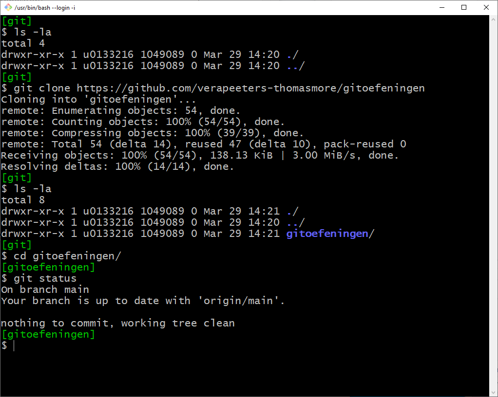
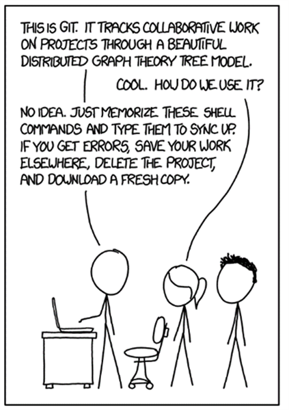

## Git Bash

| CLI = Command Line Interface |
| --- |

| GUI = Graphical User Interface |
| --- |

### Wat is Git Bash?

* Git Bash is een Linux-achtige **Command Line Interface (CLI)** voor Windows.
* Het wordt standaard meegeleverd wanneer je Git op Windows installeert.
* Mac-gebruikers gebruiken de ingebouwde **Terminal** in plaats van Git Bash.
* Tip: als je in de Windows Verkenner rechtsklikt in een map, kan je Git Bash direct in die map openen (*Open Git Bash here*).
* De meeste Linux-commando's hebben een tegenhanger in de standaard Windows Command Prompt (`cmd`). Nuttige commando's vind je in [Linux en dos commando's](../999_allerlei/linux_en_dos_commandos.md).

### Hoe werken we in deze cursus?

* In deze cursus geven we bij alle basisbegrippen steeds uitleg en screenshots voor beide manieren:
  * Met **Git Bash** (CLI): zo zie je welke commando's er onder de motorkap worden uitgevoerd.
  * Met **IntelliJ** (GUI): zo zie je hoe je dit visueel uitvoert in je IDE.
* **In de klas oefenen we enkel met IntelliJ.**
* Wil je toch commando's typen? Je kan Git-commando's ook altijd rechtstreeks uitvoeren in het **Terminal** tool-venster van IntelliJ.

---
[prev](02_installeer_git.md)
[next](04_wat_is_een_git_repo.md)
