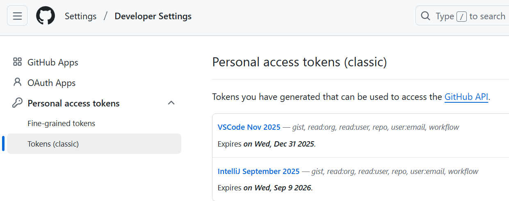
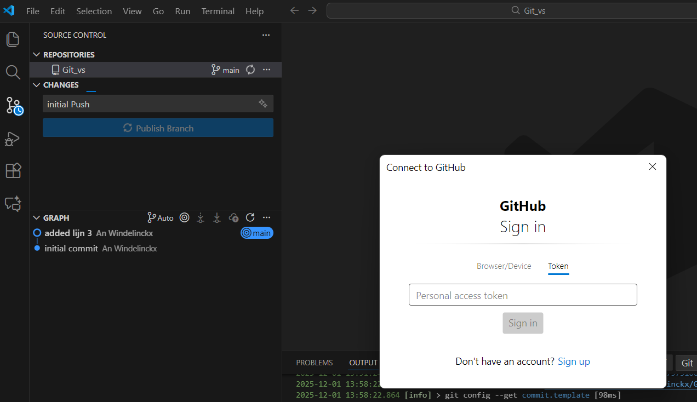

## GitHub in Visual Studio Code

Je kan in Visual Studio Code ook gebruikmaken van GitHub integraties.
In tegenstelling tot IntelliJ zijn deze functies minder 'out-of-the-box' aanwezig.
Het vergt daarom meer handmatige set-up om deze integratie goed in te stellen.

| Tip voor studenten |
|---|
| Ben je (nog) niet echt thuis in VS Code en in Version Control / Git? Open je project of folder dan in **IntelliJ** en werk daar verder. Alle oefeningen, voorbeelden en stappen in deze repository zijn gebaseerd op IntelliJ. Zo kan je altijd snel terugkijken als je even vastzit. |

### Authenticatie via Personal Access Token

Voor de authenticatie naar GitHub gebruiken we **altijd een Personal Access Token (classic)**.

#### Stap 1: Token aanmaken op GitHub
* Log in op GitHub in je browser.
* Klik rechtsboven op je profielfoto en ga naar **Settings**.
* Scroll in het linkermenu naar beneden en klik op **Developer settings**.
* Ga naar **Personal access tokens** > **Tokens (classic)**.
* Klik op **Generate new token** en kies **Generate new token (classic)**.
* Geef een duidelijke omschrijving bij **Note** (bijvoorbeeld `VSCode 2026`).
* Vink exact de volgende rechten (scopes) aan:
  * `repo`
  * `workflow`
  * `gist`
  * `read:org`
  * `read:user`
  * `user:email`
* Klik onderaan op de groene knop **Generate token**.
* **Kopieer je token direct en bewaar het veilig!** Je krijgt dit token maar één keer te zien.



#### Stap 2: Token invullen in Visual Studio Code
* Wanneer VS Code verbinding maakt met GitHub verschijnt een inlogvenster.
* Klik bovenaan op het tabblad **Token** (kies dus niet voor *Browser/Device*).
* Plak je gegenereerde token in het invoerveld **Personal access token**.
* Klik op **Sign in**.



VS Code is nu veilig geauthenticeerd met de juiste rechten.

### Basisacties in VS Code
Werk je in VS Code, dan beheer je Git via het tabblad **Source Control** (`Ctrl + Shift + G`):

* **Repository clonen:**
  * Open de Command Palette met `Ctrl + Shift + P` (macOS: `Cmd + Shift + P`).
  * Typ `Git: Clone` en druk op `Enter`.
  * Plak de URL van de GitHub repository.
  * Kies een lokale doelmap en open het project.
* **Lokaal project publiceren:**
  * Klik in het Source Control paneel op **Publish to GitHub** om je lokale code als nieuwe repository op GitHub te zetten.
* **Stage, Commit en Sync:**
  * **Stage:** Klik op het `+`-icoon naast een gewijzigd bestand onder **Changes**.
  * **Commit:** Vul een duidelijke commit message in en klik op **Commit**.
  * **Sync:** Klik op de knop **Sync Changes** (of via `...` > **Pull** / **Push**) om je lokale commits uit te wisselen met GitHub.
* **.gitignore:**
  * VS Code bewaart instellingen in een verborgen map `.vscode/`.
  * Voeg `.vscode/` toe aan je `.gitignore` bestand zodat deze map niet op GitHub belandt:
```.gitignore
.vscode/
```

---
[prev](10_share_code_between_2_computers.md)
[next](../04_branches/01_branches.md)
