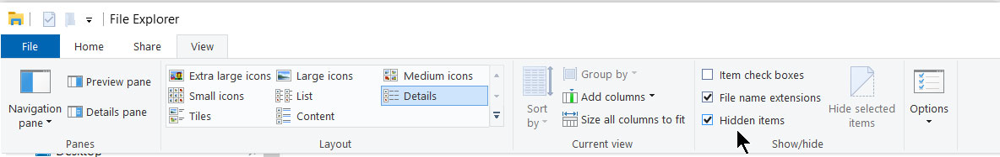

## Tips

* **Tip**: Maak ergens op je laptop een basis directory waaronder je al je programmeer projecten zet.
  * Bvb (windows): “c:/Projects” of “c:/Users/<MIJNUSERNAME>/Projects”
  * Bvb (mac): “/home/Projects”
  * Zet deze Projects directory zeker niet onder “Documents” of “Downloads” of
“Program Files”.
* **Tip**: zet nooit codeer projecten op een shared folder (zoals onedrive, googledrive, dropbox, ...). 
Dit veroorzaakt sync problemen 
* **Tip**: configureer je file explorer zodat je “hidden files” en “file extensions” altijd ziet.

  
### Terminologie

* de **root** van je project = de basis directory van je project

---
[prev](open_de_juiste_directory_in_intellij.md)
[next](tools.md)
